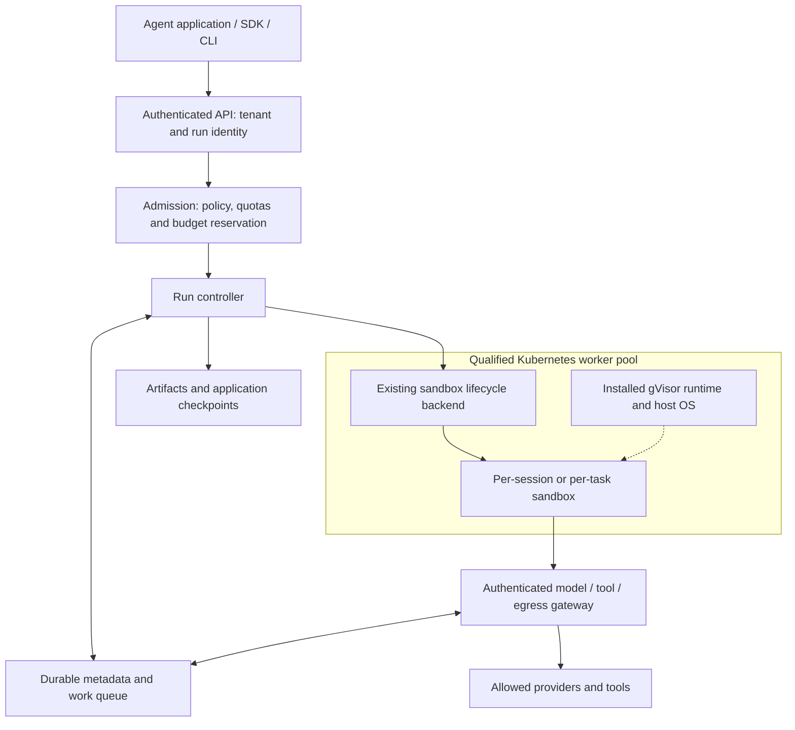

# Agent OS: product and delivery proposal

Planning date: November 18, 2026. Status: original research proposal.

Implementation has since begun with a narrower experimental execution slice; [README](../README.md) and [decision 0001](decisions/0001-initial-execution-slice.md) describe what currently exists. Delivery phases and performance gates below remain proposals; runtime performance has not been benchmarked.

## 1. Product direction

Build a common execution layer for agent fleets on Kubernetes. Give operators consistent control over identity, permissions, budgets, state, and recovery while allowing different agent frameworks and execution durations.

The founder's goals are broad workload support, an open-source project, and the possibility of eventually selling the company or project for $1–2 million. An acquisition is an aspiration, not a valuation supported by the current idea. Product decisions should create useful technology, active deployments, and paying customers.

**Recommended first customer:** a platform team already operating Kubernetes and introducing coding agents that execute repository code or customer-supplied tasks. Its security team is a key reviewer; its platform or engineering leader is the likely budget owner. This is a customer hypothesis to validate.

**Initial product promise to test:** run agent tasks in the customer's cluster with bounded permissions and resource use, recoverable application state, and an attributable record of actions and cost.

Use coding agents as the first demanding workload. Preserve generality through a small common contract, then prove it on research and durable workflows. Avoid making every workload depend on a coding-specific SDK.

## 2. One contract, several workload profiles

An **agent** is application code that makes decisions. A **session** owns continuing context and artifacts. A **run** is an accepted unit of work. An **attempt** is one execution of a run. A **sandbox** supplies isolated compute. Keeping these separate permits a long-lived session without permanently allocating a machine or Pod.

| Profile | Execution and state | First support |
| --- | --- | --- |
| Short task | Seconds or minutes; bounded input/output; ephemeral compute; retained result | MVP |
| Coding workspace | Untrusted code; files persist between runs; interactive commands; bounded access to repositories and package sources | MVP reference workload |
| Deep research | Fan-out, web access, evidence artifacts, potentially a separate browser sandbox | Second reference integration |
| Long-running workflow | Hours or days of logical lifetime; durable checkpoints; human or external-event waits release compute when safe | Early beta integration |

All profiles share tenant/run identity, cancellation, deadlines, policy decisions, budget accounting, and audit events. Profiles select resource sizes, allowed tools, persistence mode, and maximum concurrency. They do not weaken tenant boundaries.

An OCI-packaged application can execute if compatible with the selected sandbox. Automatic restart from meaningful workflow state requires application or framework cooperation. Integrate existing checkpoint systems, such as [LangGraph persistence](https://docs.langchain.com/oss/python/langgraph/persistence), rather than inventing a new agent framework.

## 3. What a specialized runtime can improve

These are problems to investigate with workload traces, not claims that every customer experiences them.

| Bottleneck | Product response | Priority / evidence |
| --- | --- | --- |
| Untrusted generated code and downloaded dependencies | Existing sandbox isolation, constrained resources, controlled tools and networking | MVP; conformance suite and compatibility runs |
| Runaway loops, subagents, or provider requests | Shared parent/child budgets, bounded fan-out, admission reservations, deadlines and revocation | MVP basics; hierarchy in beta |
| Paying for idle sessions | Park durable state and release compute at safe points; use bounded warm capacity | MVP state export; measure full infrastructure cost |
| Slow environment startup | Image prefetch, immutable templates, warm pools and dependency caching | After baseline; report warm and cold separately |
| Lost work after worker failure | Explicit checkpoint and recovery contracts; durable artifacts; fenced attempts | MVP contract; fault exercises before beta |
| Repeated external actions after retry | Brokered operations, idempotency keys, explicit ambiguous-result handling | MVP; no universal exactly-once promise |
| Noisy neighbors and unfair scheduling | Per-tenant admission, concurrency quotas, queue bounds and priority fairness | MVP; mixed-load starvation tests |
| Too much Kubernetes API traffic | Reuse upstream lifecycle objects; store high-frequency events outside Kubernetes | Measure in prototype; custom scheduling only after evidence |
| Difficult incident diagnosis | Join session, run, attempt, identity, policy, tool activity and cost in traces | MVP attribution; fleet views later |
| Expensive inference or poor model decisions | Measure separately; optionally enforce provider budgets | Model training and reasoning improvements outside initial scope |

A new execution layer cannot remove provider rate limits, guarantee good research, or make every model invocation faster. Optimize completed useful work under explicit security and reliability requirements.

## 4. Existing projects change the strategy

| Project | Documented role | Implication |
| --- | --- | --- |
| [Bottlerocket](https://github.com/bottlerocket-os/bottlerocket) | Minimal container host OS with API-driven configuration and system updates | Borrow its operational discipline; a node OS is a different layer from a runtime installed into a cluster |
| [Ate / Agent Substrate](https://ate.dev/docs/concepts/architecture/) | OCI actors, sandboxed workers, state suspension, identity and gateways; its own scheduling above Kubernetes | Direct baseline and possible foundation |
| [SIG Agent Sandbox](https://github.com/kubernetes-sigs/agent-sandbox) | Kubernetes sandbox lifecycle, templates, claims and warm pools | Preferred first lifecycle component to evaluate |
| [E2B](https://e2b.dev/enterprise) | Hosted sandbox execution and enterprise operation in customer cloud accounts | BYOC and sandboxing alone are weak differentiation |
| [Modal](https://modal.com/docs/guide/sandbox-snapshots) | Managed execution with sandbox persistence and documented snapshot constraints | Compare actual workload contracts and total cost |
| [Agno AgentOS](https://docs.agno.com/agent-os/introduction) | Application runtime serving agents and workflows | Pick a distinct public name; keep the infrastructure layer clear |

Ate advertises sub-500 ms restoration and 10× density. These are project claims, not results independently reproduced for this proposal. Its architecture also includes ambitious future scale targets. Neither should become our promised service level. [Ate website](https://ate.dev/), [architecture](https://ate.dev/docs/concepts/architecture/).

Ate's published security status identifies unfinished quotas, portions of snapshot protection, and some authorization capabilities; application lineage is outside its scope. Those observations suggest experiments, not permanent competitive gaps or validated vulnerabilities. Recheck the current release before a build decision. [Security status](https://ate.dev/docs/security/security/).

**Differentiation hypothesis:** consistent task permissions, hierarchical budgets, recovery rules, and incident evidence across several workload profiles. Validate this with customers and current competitor tests. A collection of existing features is not a moat by itself.

## 5. Architecture and reuse decision

The application control plane runs as containers in Kubernetes. Workloads execute in separate sandboxes on prepared workers. A container image does not replace the host kernel. A literal Bottlerocket equivalent would require distributing and maintaining a node OS.

**Proposed default:** SIG Agent Sandbox with gVisor, plus our API, admission, gateway, and run metadata. During discovery, compare an equivalent thin layer over Ate. Select one foundation for the prototype. Keep a narrow backend interface without implementing multiple backends immediately. If existing products already satisfy the customer need, contribute upstream or build the commercial operations layer instead.

Use [RuntimeClass](https://kubernetes.io/docs/concepts/containers/runtime-class/) on qualified nodes. Installing a Helm chart cannot install or guarantee every runtime configuration. Reject execution if the required sandbox handler or network enforcement is unavailable; never silently fall back to ordinary container isolation.

gVisor is the initial compatibility and operations candidate. Its systrap platform avoids a KVM requirement; workload compatibility still needs testing. A later VM tier can use Kata on capable nodes. Direct Firecracker integration introduces guest image, networking, storage and lifecycle responsibilities and is not the first implementation. [gVisor platforms](https://gvisor.dev/docs/architecture_guide/platforms/), [Kata](https://github.com/kata-containers/kata-containers), [Firecracker prerequisites](https://github.com/firecracker-microvm/firecracker/blob/main/docs/getting-started.md).

Suggested implementation choices, subject to the discovery spike:

- Go for the Kubernetes controller and API; thin Python client and CLI for the first examples.
- PostgreSQL for run metadata, admission reservations and a durable work table; avoid a separate queue service until measurements justify one.
- Object storage for artifacts and exported checkpoints; a qualified volume backend for active coding workspaces. Track volume count and attach latency.
- OpenTelemetry for traces and metrics; never emit a Kubernetes object or event for every token or tool output.
- One supported Kubernetes/node/CNI/runtime combination first. Add distributions, architectures and clouds through a tested compatibility matrix.

## 6. Contracts to specify before coding

**Identity and policy.** Derive tenant identity from authenticated admission. Applications cannot choose another tenant or manufacture parentage. Assign immutable run/session IDs and attempt generations. Record image digest, policy version and initiator. Child agents inherit a subset of permissions and share a bounded root budget. Limit delegation depth, fan-out and concurrency.

**Execution state.** A run moves from accepted to queued, starting and running, then succeeds, fails or is cancelled. Checkpoint-aware applications can enter a durable waiting state and later start a new attempt. Accepted work is durably recorded before acknowledgment. Reconciliation is idempotent; terminal states cannot be resurrected by stale callbacks.

**External effects.** Work delivery may happen more than once. Privileged gateway requests must carry the current run generation. Fence stale attempts at the gateway and protect checkpoint commits against stale writers. A lease alone cannot stop a partitioned executor. For external effects, require provider idempotency support, connector-level deduplication, or manual handling of uncertain outcomes. Cancellation blocks new brokered actions, then stops compute; it cannot undo an external action already submitted. [Temporal activity idempotency](https://docs.temporal.io/activity-definition#idempotency).

**Workspace ownership.** Ordinary mounted filesystems do not enforce attempt-generation tokens. Prefer isolated writable storage per attempt, restored from an immutable committed checkpoint; only the current generation may publish the next checkpoint. If a backend reuses a writable workspace volume, it must establish single-writer fencing under node loss and partitions before starting a replacement writer. Checking metadata ownership alone does not protect files from the previous executor.

**Credentials and tools.** Keep reusable upstream secrets in the trusted broker. Sandboxes may hold short-lived, scoped capabilities. Support a small explicit set of model and tool protocols first. For sensitive tools, authorize operation and arguments, not only a destination hostname. Approval records bind tenant, run, operation payload and expiry and are checked by the broker. Arbitrary TLS passthrough cannot provide the same inspection or credential-injection guarantees.

**Networking and isolation.** Default-deny workload traffic and allow only required gateway paths. Verify DNS, IPv4/IPv6, metadata endpoints, node services, peer sandboxes and Kubernetes API reachability on the actual cluster. Standard NetworkPolicy depends on the enforcing plugin, is additive and has local-node limitations; additional node/CNI controls are needed for the intended boundary. A domain allowlist does not prevent data misuse through an allowed service. [Kubernetes network policy](https://kubernetes.io/docs/concepts/services-networking/network-policies/).

Workload admission accepts validated execution parameters against administrator-owned templates, not arbitrary PodSpecs. Prohibit privileged workloads, host namespaces, hostPath or runtime-socket mounts, and arbitrary device access. Disable automatic Kubernetes service-account token mounting for workloads. RuntimeClass selection cannot make an exposed host mount or broad credential safe; keep backend infrastructure privileges separate from agent privileges.

**Resources and budgets.** Enforce CPU, RAM, PID, disk, execution-time, queue and concurrency limits. Reserve a supported request's upper cost bound before provider submission; reconcile observed usage afterward. Bound in-flight calls and output tokens. Strict-budget mode rejects adapters without a defensible upper bound. Distinguish admission limits from actual provider invoices, which can lag or differ. Accounting failure blocks new billable actions while cancellation remains available. Keep storage retention and idle warm capacity in cost attribution.

**State and suspension.** MVP durability is application checkpoints plus files, not transparent process migration. Suspend only at an acknowledged safe point: flush state, commit a complete manifest, then release compute. Plain OCI processes without checkpoint support can keep running or restart under a documented contract. Do not freeze arbitrary in-flight provider requests, browser sockets or transactions and assume they remain valid.

Memory snapshots are a later backend capability. They require compatibility, current restore authorization, encryption, credential renewal and isolation tests. gVisor documents CPU and network constraints; Firecracker documents possible lost connections. SIG Agent Sandbox's documented snapshot path currently uses GKE-specific resources and a Python client. These are not a portable guarantee for every cluster. [gVisor checkpoints](https://gvisor.dev/docs/user_guide/checkpoint_restore/), [Firecracker snapshots](https://github.com/firecracker-microvm/firecracker/blob/main/docs/snapshotting/snapshot-support.md), [Agent Sandbox snapshots](https://agent-sandbox.sigs.k8s.io/docs/sandbox/snapshots/).

**Operations.** Use fresh unassigned warm sandboxes; do not reassign a used tenant workspace to another tenant. Bound log and artifact size, redact credentials, define retention, and authenticate every read. New privileged actions fail closed if policy authority is unavailable. Running compute retains local deadlines; recovery reports the last durable checkpoint and any uncertainty.

## 7. Delivery sequence

Timings below assume roughly two experienced engineers and access to platform/security reviewers. They are estimates, not delivery commitments. Broader cloud support or a custom sandbox changes them substantially.

| Phase | Scope | Exit gate |
| --- | --- | --- |
| Weeks 1–2: discovery | Customer interviews; coding and research traces; compare Ate and Agent Sandbox; choose one node environment and foundation | Three potential design partners and a repeated, costly problem; written build/reuse decision |
| Weeks 3–6: working slice | Authenticated submit/status/cancel; isolated execution; bounded queue/resources; one model connector and one tool connector; artifacts and audit IDs | Python and Node reference tasks work; policy denial, timeout and cancellation are demonstrated |
| Weeks 7–12: testable alpha | Application checkpoints; accounting reservations; recovery/fencing; warm-capacity experiments; installer preflight and evaluation harness | Reproducible results, published limitations, and a real customer workload deployed |
| Months 4–6: design-partner beta | Three distinct workload examples; child budgets; external-event waits; backups, upgrades and operational runbooks | Two paid pilots with agreed acceptance criteria; sustained operation and independent security review |
| Months 6–12+: production scope | Support matrix, release maintenance, recovery drills, tenant-boundary review and support ownership | Evidence-based SLOs and customers using it routinely without founder intervention |
| After product evidence | Multi-cluster fleet operations, additional isolation tiers, selected memory-snapshot support | Each addition tied to a customer requirement and measured benefit |

A custom Linux distribution, new hypervisor, inference engine, vector database, agent-building UI and universal workflow engine are outside the first delivery scope. A hardened node image becomes a separate proposal if host configuration is a demonstrated blocker.

## 8. Validation and commercial path

Interview 12–15 qualified platform/security teams. Ask about their last failed or unsafe agent run, current deployment, recovery work, workload distribution and procurement process. Seek at least five independent accounts of the same problem. Three design partners should supply workload evidence; at least two should install a prototype. Interest without deployment is weak evidence.

Before each pilot, agree on the baseline, acceptance conditions, data handling, a named budget owner and a price. Seek two paid pilots before broad feature expansion. Measure completed policy-compliant tasks, cost, provisioning latency, recovery effort and repeat usage. Pivot if the recurring problem is mostly prompt quality, search quality or agent-authoring UX.

Keep a useful self-hosted core open source: execution API, baseline security controls, one backend, policy contracts, telemetry, examples and reproducible evaluations. Apache-2.0 is a proposed license; select it after checking dependency licenses and contribution ownership. Establish contribution guidance, release ownership, a vulnerability reporting path and supported-version policy before public runtime releases.

Commercial candidates are managed operation in the customer's cloud, multi-cluster fleet administration, enterprise integrations, deployment assistance and support. Test which one buyers fund. Baseline isolation and access controls remain part of the core product. Avoid a business model that charges for fixing an unsafe free deployment.

Illustrative pricing experiment: a $2,500/month platform/support contract for a qualified customer. Ten such customers would be $300,000 annual recurring revenue. This is arithmetic for a pricing hypothesis, not demand evidence, a forecast or an acquisition valuation. Customer cloud and model bills would be separate under this model.

A potential buyer would need a reason to acquire rather than reproduce the product. Useful assets include recurring revenue and renewals, deployments with continuing usage, maintainable technology, documented operational knowledge, clear contribution ownership and distribution into a defined customer group. There is no defensible $1–2 million sale prediction from the current feature proposal.

Resource estimate: approximately 6–12 engineer-months through a deliberately constrained alpha or initial beta on existing components, excluding later production hardening and ongoing support. A founder can run discovery and a prototype alone; production response and continuity require additional ownership. For illustration, six engineer-months at an assumed fully loaded $15,000 per month is $90,000, before infrastructure, external review and sales. This is a budgeting assumption, not a market quote; founder time can substitute for cash but remains work.

## 9. Next decisions and first experiments

1. **Select two initial workload traces:** a short Python/Node tool task and a stateful coding task with idle gaps. Add a research task to check that the contract generalizes.
2. **Interview before broad implementation:** record buyer, current workaround, cost of failure and willingness to deploy.
3. **Run a foundation spike:** execute equivalent tasks on Ate and Agent Sandbox with declared isolation settings. Record compatibility, missing controls, required privileges and operational complexity.
4. **Write the first contract:** identities, permissions, resource limits, accepted-work semantics, cancellation and checkpoint behavior. Finalize only the fields the working slice needs.
5. **Choose the product shape:** extend upstream, add a governance/operations layer, or build a thin independent controller. A custom substrate requires evidence that extension is insufficient.
6. **Choose a public name and release scope:** keep “Agent OS” internal until naming and ownership are resolved; publish only capabilities demonstrated by the evaluation harness.

Proceed beyond discovery when a repeated customer problem and a feasible differentiated solution are both visible. Use the [evaluation plan](EVALUATION_PLAN.md) to make technical claims reviewable.
